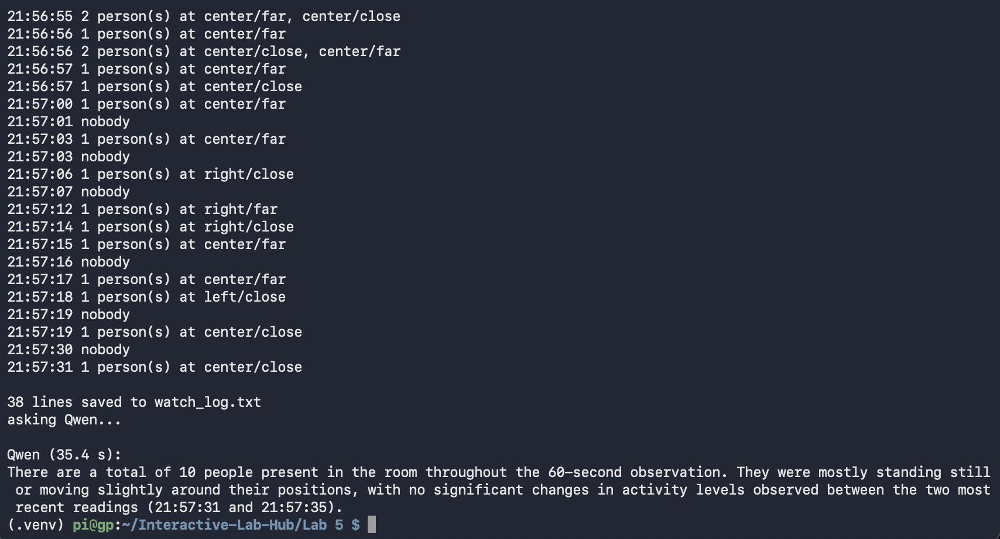

# Observant Systems: Overnight Sensation

**Team:**

**Members:** [Neeha Ravula](https://github.com/neeharavula/Interactive-Lab-Hub/tree/Fall2026) (nr485), [Gaurav Patel](https://github.com/Gtpatel02/Interactive-Lab-Hub) (gp438), [Nishant Ray](https://github.com/Nishant-Ray/Interactive-Lab-Hub) (nr487)

**Project name:**

<details>
	<summary><strong>Instructions for Students (Click to Expand)</strong></summary>
  
	**Submission Cleanup Reminder:**
	- This README.md contains extra instructional text for guidance.
	- Before submitting, remove all instructional text and example prompts from this file.
	- You may delete these sections or use the toggle/hide feature in VS Code to collapse them for a cleaner look.
	- Your final submission should be neat, focused on your own work, and easy to read for grading.
  
	This helps ensure your README.md is clear, professional, and uniquely yours!

  ```
  pi@raspberrypi:~$ cd Interactive-Lab-Hub/Lab\ 5
  pi@raspberrypi:~/Interactive-Lab-Hub/Lab 5 $ python3 -m venv .venv
  pi@raspberrypi:~/Interactive-Lab-Hub/Lab 5 $ source .venv/bin/activate
  (.venv) pi@raspberrypi:~/Interactive-Lab-Hub/Lab 5 $ pip install -r requirements.txt
  ```
</details>
 

## Overview

**Part 1: the tools**

A) [Set up your Pi for on-device AI](#part-a)

B) [See: recognize people in real time with YOLO](#part-b)

C) [See more: hands and pose with MediaPipe](#part-c)

D) [Reason: run Qwen on the Pi with Ollama](#part-d)

E) [Connect: from YOLO readings to Qwen reasoning](#part-e)

**Part 2: Overnight Sensation**

F) [Read Part 2 and storyboard your night-time interaction](#part-f)

G) [Design the interaction before bed](#part-g)

H) [Incorporate the observant system during sleep](#part-h)

I) [Design the interaction when awake](#part-i)

---

# Part 1

## Part A. 
### Set up your Pi for on-device AI

**Downloaded Ollama models:**


## Part B. 
### See: recognize people in real time with YOLO

\*\*\***Include a short video or screenshots of your experiments with the person detection. Write down three situations where it did not see you, or saw a person who was not there, and what you think the cause was.**\*\*\*

Normal Run:

https://github.com/user-attachments/assets/1a05d733-c15a-4d1c-a962-67a4480fe0e8


Conf 0.2 Run:

https://github.com/user-attachments/assets/9067856e-9f18-48fc-8372-b3514c863c17

Conf 0.7 Run:

https://github.com/user-attachments/assets/85584b70-177f-4a23-9fba-e7f75ee74735

All Run:

https://github.com/user-attachments/assets/4f3ac2dd-5ef0-4311-a953-523dd6e1ac79

Headless Run:

https://github.com/user-attachments/assets/206a35e1-6907-4a61-a05e-ca643d327f8e


Observations:
- In the `--conf 0.2` experiment, while walking around, YOLO briefly detected a nonexistent person at the side of the frame with a confidence of 0.37. Background shapes or shadows may have resembled a person, and the lower threshold allowed this uncertain detection to appear.
- In the `--conf 0.7` experiment, for a few seconds, YOLO did not draw a box correctly. Movement, changes in pose, or partial visibility may have lowered its confidence below 0.7, causing the stricter threshold to filter out the detection.
- In headless mode, the printed readings briefly showed no person detection. Movement or an unfamiliar viewing angle may have caused a temporary detection failure. Headless mode only removes the display, rather than change the model’s accuracy, so a possible explanation is that moving or turning briefly made the body harder to recognize, lowering the model’s confidence below the detection threshold.
- In `--all` mode, YOLO correctly identified a chair but briefly labeled something at the side as a refrigerator. Background edges or rectangular shapes may have resembled features the model associates with refrigerators.


## Part C. 
### See more: hands and pose with MediaPipe

\*\*\***Include a screenshot or short video of the hand pose demo, and write how you might use face, hand or body pose tracking in your observant system.**\*\*\*

https://github.com/user-attachments/assets/feffde71-29b8-4efa-85b6-00f44571db8b


## Part D. 
### Reason: run Qwen on the Pi with Ollama

\*\*\***Ask Qwen three questions to answer. Paste the questions, the answers and how long each took. Try one of them with `qwen3:0.6b` and compare.**\*\*\*

We asked `qwen3.5:0.8b` three questions through `ask_qwen.py` (thinking off, three-sentence instruction, 120-token cap) and repeated the first with `qwen3:0.6b`.

**Q1: "Tell me a bit about the history of Roosevelt Island."** (factual recall)

**qwen3.5:0.8b (20.7 s)**
> Roosevelt Island was originally built as a private residence for President Theodore Roosevelt, who commissioned it to house his family and office. The island's development began in 1907 when the city purchased the land from the Hudson River Company, allowing the construction of the iconic "Gilded Cage" hotel complex.

**qwen3:0.6b (16.5 s)**
> Roosevelt Island, located in the United States, has a rich history dating back to the early 19th century. It was initially a military base for the Union Army during the Civil War, and it became a significant naval base in the 19th and early 20th centuries. The island played a crucial role in the Pacific War and was home to several important military personnel, including notable figures like Admiral Nelson. Today, Roosevelt Island is a peaceful and historic site, preserving the legacy of those who once called it home.

| Ground-truth fact | 0.8b | 0.6b |
|---|---|---|
| Formerly Blackwell's Island | ❌ | ❌ |
| Then Welfare Island | ❌ | ❌ |
| Renamed in 1973 | ❌ | ❌ |
| Cornell Tech opened in 2017 | ❌ | ❌ |

Both models scored 0/4 and confidently invented a history. The 0.8b model named the wrong Roosevelt (the island is named for FDR), put the island on the Hudson (it is in the East River), and made up a "Hudson River Company" and a "Gilded Cage" hotel. The 0.6b model was faster but no more accurate: it invented a Civil War Union Army base, a naval base, a role in the Pacific War and Admiral Nelson (a British admiral who died in 1805), and it ignored the three-sentence limit. Its only roughly true claim was that the island's history goes back to the early 19th century.

**Q2: "What is in this photo?"**

> A man with glasses and a beard is taking a selfie in a dimly lit room.

Correct, including the selfie: the photo was taken holding up the webcam. This was the slowest question because the model also has to process the image, but it was the only fully accurate answer. The difference from Q1 is that here the model had real data to describe instead of recalling facts from memory.

**Q3: "Why did Cornell Tech move off Roosevelt Island in 2010?"** (false premise, 7.8 s)

> Cornell Tech moved to Roosevelt Island in 2010 because the city's zoning laws made it impossible for a new university campus to be built there, forcing them to relocate to nearby areas.

The model accepted the false premise instead of correcting it. Cornell Tech never moved off the island; it opened there in 2017. The answer also contradicts itself (it "moved to" the island because it was impossible to build there) and invents a zoning law. This was the fastest answer (7.8 s) because the model was already loaded and the reply was short, which suggests the earlier times include model loading.

**Takeaways**
- On a Pi 5, answers take roughly 8–33 s depending on whether the model is already loaded, how long the answer is, and whether there is an image.
- The smaller `qwen3:0.6b` was a little faster but no more accurate, and it followed the length instruction less well.
- Asked to recall facts, both models invent confidently; given a false premise, the model plays along. Given actual data (the photo), it was accurate.
- For our observant system this means Qwen should never answer from its own knowledge. It should only summarize the data we give it (the YOLO log), with a narrow job and a fallback for when the data is empty or unclear.


## Part E. 
### Connect: from YOLO readings to Qwen reasoning



---

# Lab 5 Part 2: Overnight Sensation

For Part 2, you will use the observant system from Part 1 to design a night-time interaction. On-device AI is slow, so let it work while you sleep. The person meets the device twice: **before bed**, when they hand the night over, and **when awake**, when the device gives something back. In between, the pipeline from Part E runs on its own.

Two flavors, pick one or mix them:

* **Sense all night.** The Pi watches, listens or measures from bedtime until morning and keeps a log.
* **Process all night.** You already have the data (a day of phone photos, a long recording) and the Pi needs hours to get through it.

Two house rules. Sample rather than stream: one look every 5 to 30 seconds is plenty, and it keeps the Pi cool. And keep everything on the Pi: tell the people you live with, point the camera at things rather than at beds, and delete the snapshots after the demo.

## Part F. 
### Read Part 2 and storyboard your night-time interaction

Storyboard a night-time interaction built on your observant system, in three panels:

1. **Before bed.** How does the person hand the night over, and how does the device acknowledge it?
2. **While asleep.** What does the device watch or work through?
3. **When awake.** What is the one thing the person learns, and in what medium?

Stuck? A kitchen that tells you who raided the fridge. A desk that reports whether you actually went to bed. A window that names the quietest hour. A plant that describes its night. Find something better.

Use storyboards and/or [Verplank diagrams](https://ccrma.stanford.edu/courses/250a-fall-2004/IDSketchbok.pdf).

\*\*\***Insert ideas, sketches, Verplank diagrams and storyboards for your night-time interaction here.**\*\*\*

## Prep for Part 2

1. Look at and give feedback on the Part F storyboards.
   **Put the feedback for your ideas here.**
2. [Update your Lab Hub](prep.md#get-the-latest-content) to get the latest content for Part 2.
3. Decide where the device will spend the night and who else lives there. Get their OK before the first run.
4. Revise your storyboard with the feedback and with what you learned in Part E about where the pipeline breaks.

\*\*\***Post your revised storyboard here.**\*\*\*

## Part G. 
### Design the interaction before

The hand-off: the person tells the device what to watch tonight, and the device acknowledges it. Keep it to a thirty-second ritual. A button or a touch (Lab 4), a spoken sentence (Lab 3), a wave or a Quiet Coyote at the camera (Part C). The acknowledgement can be a line on the display, a tone, or an LED that dims rather than lights up. At its simplest, the hand-off just sets the question that the morning will answer.

\*\*\***Describe the interaction before.**\*\*\*

## Part H. 
### Incorporate the observant system

The Part E pipeline becomes the night shift. `overnight.py` runs your `interpret()` from `yolo_to_qwen.py` every few seconds, people only unless you pass `--all`, and writes the readings to `night_log.jsonl`; the reasoning waits for the morning. Start it inside `tmux` so it keeps running after you close your laptop, and stop it with Ctrl-C in the morning:

```
(.venv) pi@raspberrypi:~/Interactive-Lab-Hub/Lab 5 $ tmux new -s night
(.venv) pi@raspberrypi:~/Interactive-Lab-Hub/Lab 5 $ python overnight.py
```

Fake a night first: run it for thirty seconds while you walk around, stop it, and run `morning.py` from Part I. When that looks right, run a real night. If your storyboard needs a sensor rather than the camera, swap in the Lab 4 example code and log its reading the same way.

\*\*\***Screenshots or videos of the running system.**\*\*\*

## Part I. 
### Design the interaction after

The reveal. The night produced a log; the morning turns it into something a half-awake person can take in. `morning.py` is the smallest version: it asks Qwen for a three-sentence report.

```
(.venv) pi@raspberrypi:~/Interactive-Lab-Hub/Lab 5 $ python morning.py
```

Make it yours: show the report on the Mini PiTFT, read it aloud with Piper from Lab 3, plot the night as a timeline, or ask for JSON (`--json`, Part D) and move a servo. Whatever you pick, make sure it is honest about a night in which nothing happened.

## Final documentation

Document all the prototypes and iterations you have designed and worked on. The deliverables for this lab are writings, sketches, photos, and videos that show what your system:

* "Looks like": how the device sits in the room at night, and what it looks like at bedtime and in the morning.
* "Works like": the pipeline from detector to interpreter to log to reasoner, with a real night's data.
* "Acts like": how a person hands the night over and what they get back.

\*\*\***Include a short video of the whole system**\*\*\*

As always, make sure you document contributions and ideas from others (and AI) explicitly in your writeup.

You are permitted (but not required) to work in groups and share a turn in; you are expected to make equal contribution on any group work you do, and N people's group project should look like N times the work of a single person's lab. Make sure the page for the group turn in is linked to your personal Interactive Lab Hub page.

## Deliverables & Submission for Lab 5

For submission, the readme.md page for this lab should be edited to include the work you have done:
* Upload any materials that explain what you did, including your code and night log, into your Lab 5 repository, and link them in your Lab 5 readme.md.
* Labs are due on Sundays, make sure to submit your Lab 5 readme.md to Canvas.

<details>
  <summary><strong>Submission Cleanup Reminder (Click to Expand)</strong></summary>

  **Before submitting your README.md:**
  - This readme.md file has a lot of extra text for guidance.
  - Remove all instructional text and example prompts from this file.
  - You may either delete these sections or use the toggle/hide feature in VS Code to collapse them for a cleaner look.
  - Your final submission should be neat, focused on your own work, and easy to read for grading.
</details>
